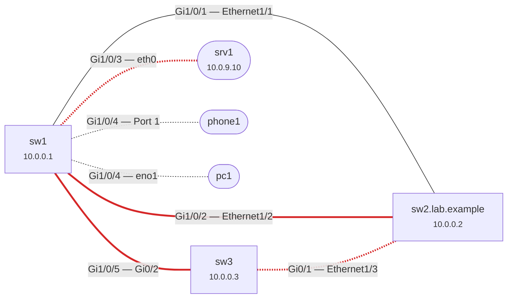

# lldp-mapper

Layer-2 topology discovery over SNMP, from the **LLDP-MIB** and **CISCO-CDP-MIB**
neighbour tables, with a check of every discovered link for the problems
LLDP/CDP make visible:

| Code | Severity | What it means |
|------|----------|---------------|
| `duplex-mismatch` | critical | One end runs full duplex, the other half duplex: late collisions, CRC errors, throughput collapsing under load. |
| `speed-mismatch` | warning | The two ends report different speeds (media converter, wrong optic, stale advertisement). |
| `autoneg-mismatch` | warning | Auto-negotiation on at one end, off at the other: the classic root cause of duplex mismatches. |
| `native-vlan-mismatch` | warning | Different native/untagged VLAN (PVID) at each end: untagged frames leak between VLANs, STP inconsistencies. |
| `one-way-adjacency` | warning | A sees B on a port but B, which was polled and runs the protocol, sees nobody there: LLDP/CDP transmit or receive disabled on one side, or a unidirectional link. |
| `neighbor-mismatch` | warning | A sees B on B's port P, but B sees a third device on P: patching error, intermediate device, stale entry. |
| `shared-port` | info | Several neighbours behind one port: unmanaged switch, hub, IP phone with a PC behind it, hypervisor. |
| `poll-failed` | unknown | The device did not answer (agent down, ACL, wrong credentials or version). |
| `partial-data` / `no-discovery-data` / `duplicate-device` | info | Some tables timed out; neither LLDP nor CDP data; the same box reached through two addresses. |

The result is printed as a text report, **JSON**, a **Mermaid** graph (renders
in GitHub, GitLab, Confluence, Obsidian...) or a **Graphviz DOT** graph.
Links with a finding are drawn in red, links seen from one side only are dashed.

Pure Python (3.9+), standard library only. lldp-mapper is **read-only**: it
only ever sends SNMP GetNext/GetBulk requests.

## How it works

1. Every target is walked (24 subtrees, a few dozen GetBulk requests on a 48-port
   switch): system group, IF-MIB, IP-MIB addresses, EtherLike-MIB duplex,
   LLDP-MIB local/remote/management-address tables, LLDP-EXT-DOT1 (PVID) and
   LLDP-EXT-DOT3 (auto-negotiation, operational MAU type), Q-BRIDGE `dot1qPvid`,
   CISCO-CDP-MIB, CISCO-VTP-MIB trunk native VLAN and CISCO-VLAN-MEMBERSHIP-MIB
   access VLAN. A device that does not implement a MIB simply returns nothing
   for it.
2. **LLDP local port numbers are mapped to ifIndex properly** (they are not
   guaranteed to be equal): by port ID against ifName/ifDescr/ifAlias, then
   port description, then the Junos convention (local port ID = ifIndex), and
   only then by assuming `lldpLocPortNum == ifIndex`.
3. Neighbours are matched to polled devices by **chassis ID**, then system
   name / CDP device ID (case-insensitive, NX-OS `name(SERIAL)` suffix and
   domain stripped when unambiguous), then management address; a name or
   address never merges two boxes with different chassis IDs. The remote port
   is resolved against the neighbour's own `lldpLocPortTable` (exact port ID
   match), so `Gi1/0/1`, `GigabitEthernet1/0/1` and MAC-based port IDs all land
   on the same port. An LLDP and a CDP sighting of the same cable become one link.
4. Each end of each link gets **facts with their source**: what the device
   says about its own port (EtherLike duplex, ifHighSpeed, local MAU type,
   local auto-negotiation, PVID) always wins over what the neighbour received
   in LLDP/CDP advertisements. Mismatches are only reported when both ends are
   known. `--verbose` and the JSON output show where every value came from.

## Installation

```sh
pipx install "git+https://github.com/Hug0devSYS/sysnet-toolbox.git#subdirectory=tools/lldp-mapper"
# or, from a checkout:
cd tools/lldp-mapper && pip install .
```

SNMPv3 additionally needs net-snmp's command-line tools (`apt install snmp`,
`dnf install net-snmp-utils`, `brew install net-snmp`).

## Usage

```
lldp-mapper [options] TARGET...
lldp-mapper --from-walks DIR_OR_FILE...
```

Credentials are **never** taken from the command line (they would show up in
`ps` and shell history):

* SNMPv1/v2c: community in `$SNMP_COMMUNITY` (`--community-env` to use another
  variable) or in the first line of `--community-file` (warned about if group-
  or world-readable).
* SNMPv3: `--user NAME`, `--auth-proto {MD5,SHA,SHA-224,SHA-256,SHA-384,SHA-512}`,
  `--priv-proto {DES,AES,AES-192,AES-256}`; passphrases in `$SNMP_AUTH_PASS` and
  `$SNMP_PRIV_PASS`. SNMPv3 runs through `snmpbulkwalk`; the credentials are
  written to a private temporary `snmp.conf` (directory 0700, file 0600, removed
  at exit) instead of its argv.

| Option | Default | |
|--------|---------|-|
| `-f FILE` | | targets file, one per line, `#` comments |
| `-s {1,2c,3}` | `2c` | SNMP version |
| `--backend {auto,native,net-snmp}` | `auto` | built-in client for v1/v2c, net-snmp for v3 |
| `--timeout` / `--retries` | 2 s / 2 | per request |
| `--max-repetitions` | 25 | GetBulk size; halved automatically on `tooBig` |
| `--device-timeout` | 120 s | budget for all walks of one device; a device that stops answering mid-poll keeps the tables already read |
| `--workers` | 8 | devices polled in parallel |
| `--crawl --scope CIDR` | off | also poll neighbours via their advertised management address, **only inside `--scope`**, up to `--max-depth` (3) and `--max-devices` (256), only neighbours advertising `--crawl-caps` (`bridge,router`) |
| `--format {text,json,mermaid,dot}` / `--json` | `text` | standard output |
| `--graph FILE` | | also write `.mmd`/`.mermaid`, `.dot`/`.gv` or `.json`; repeatable |
| `--save-walks DIR` | | save each device's raw walk (`DIR/<target>.walk`) |
| `--from-walks PATH` | | offline analysis of saved walks or of `snmpbulkwalk -On` output |
| `--min-severity`, `--ignore CODE` | | filter findings (also for the exit code) |
| `-v`, `--progress` | | link facts with sources; per-device progress on stderr |

Exit codes (Nagios/Icinga compatible): `0` OK, `1` warning finding(s), `2`
critical finding(s), `3` unknown: only poll failures, every poll failed, or a
usage error. A run with a critical finding and an unreachable device exits 2;
the unreachable device is still listed as `poll-failed`.

## Examples

```sh
export SNMP_COMMUNITY='...'   # or: --community-file /etc/lldp-mapper/community

# Two core switches, text report
lldp-mapper core1.example.net core2.example.net

# Crawl the management network from one seed, write Mermaid + JSON for the wiki/CMDB
lldp-mapper --crawl --scope 10.10.0.0/16 core1 --graph topo.mmd --graph topo.json

# SNMPv3 authPriv, targets from a file, Nagios check that ignores shared ports
SNMP_AUTH_PASS=... SNMP_PRIV_PASS=... \
  lldp-mapper -s 3 --user nms --auth-proto SHA-256 --priv-proto AES -f access-switches.txt --ignore shared-port

# Offline: a colleague sends you walks; or you keep them for a before/after comparison
snmpbulkwalk -v2c -c "$SNMP_COMMUNITY" -On -Ox sw1 .1 > walks/sw1.walk
lldp-mapper --from-walks walks/ --format dot | dot -Tsvg > topology.svg
```

Sample report (three switches from the test lab):

```
lldp-mapper 0.1.0: 3 device(s) polled, 6 node(s), 7 link(s)

Devices
  sw1              10.0.0.1  7 neighbour(s)  LLDP+CDP  0.4s
  sw2.lab.example  10.0.0.2  2 neighbour(s)  LLDP      0.3s
  sw3              10.0.0.3  2 neighbour(s)  LLDP      0.2s

Links
  sw1  Gi1/0/4  <->  pc1              eno1         LLDP      ok (peer not polled)
  sw1  Gi1/0/4  <->  phone1           Port 1       LLDP      ok (peer not polled)
  sw1  Gi1/0/3  <->  srv1             eth0         LLDP      duplex-mismatch
  sw1  Gi1/0/1  <->  sw2.lab.example  Ethernet1/1  LLDP+CDP  ok
  sw1  Gi1/0/2  <->  sw2.lab.example  Ethernet1/2  LLDP      native-vlan-mismatch
  sw1  Gi1/0/5  <->  sw3              Gi0/2        LLDP      autoneg-mismatch
  sw3  Gi0/1    <->  sw2.lab.example  Ethernet1/3  LLDP      one-way-adjacency

Findings
  CRITICAL duplex-mismatch: duplex mismatch on sw1 Gi1/0/3 <-> srv1 eth0: full vs half (late collisions, CRC errors and throughput collapse under load)
  WARNING  autoneg-mismatch: auto-negotiation enabled on sw1 Gi1/0/5 but disabled on sw3 Gi0/2: the negotiating side falls back to half duplex on copper (the classic cause of duplex mismatches)
  WARNING  native-vlan-mismatch: native/untagged VLAN mismatch on sw1 Gi1/0/2 <-> sw2.lab.example Ethernet1/2: 1 vs 10 (untagged frames leak between VLANs, STP inconsistencies)
  WARNING  one-way-adjacency: sw3 Gi0/1 sees sw2.lab.example Ethernet1/3 via LLDP, but sw2.lab.example has no LLDP neighbour on that port (transmit/receive disabled on one side, or a unidirectional link)
  INFO     shared-port: sw1 Gi1/0/4 has 2 neighbours (pc1, phone1): unmanaged switch, hub, IP phone with a PC behind it, or a hypervisor

CRITICAL: 1 critical, 3 warning, 0 unknown, 1 info (exit 2)
```

With `-v`, every fact shows its source, e.g.
`srv1 eth0: duplex=half [advertised via LLDP, received by sw1 (MAU 100BaseTXHD)]`.

Mermaid output of the same run (`--format mermaid`):



The JSON document has `summary`, `devices` (per-poll status, request count,
duration), `nodes` (polled and discovered, with chassis ID, management
addresses, capabilities), `links` (both ends with their facts and sources,
protocols, `seen_from`, `bidirectional`, findings) and `findings`.

## Limitations

* **LLDP-V2-MIB** (`1.3.111.2.802.1.1.13`, used by some recent Huawei/Extreme
  firmware instead of the 2005 LLDP-MIB) is not read yet; nor are vendor MIBs
  other than Cisco's (Juniper, Arista, Aruba/HPE and Cisco NX-OS implement the
  standard LLDP-MIB).
* On Cisco IOS, BRIDGE-MIB/Q-BRIDGE-MIB tables are per VLAN context
  (`community@vlan`); the native/access VLAN therefore comes from
  CISCO-VTP-MIB / CISCO-VLAN-MEMBERSHIP-MIB, or LLDP-EXT-DOT1 when enabled
  (`lldp tlv-select` / 802.1 TLVs).
* Duplex/speed checks need data from **both** ends: the device's own MIBs, or
  the neighbour's LLDP 802.3 TLVs / CDP duplex. Many servers do not send the
  802.3 MAC/PHY TLV (lldpd does, Windows does not).
* LAG members are compared one by one; LACP partner consistency is out of
  scope (see the `bond-check` idea in the roadmap for Linux hosts).
* The built-in client speaks SNMPv1/v2c only; SNMPv3 (USM authentication and
  privacy) is delegated to net-snmp rather than re-implementing the crypto.
* IPv6 targets work with both back-ends; crawling uses whatever management
  addresses neighbours advertise (IPv4 or IPv6) inside `--scope`.

## Security

* Read-only by construction: the client has no Set request code at all.
* Credentials only from environment variables or a file; never in argv, never
  in output, never in saved walks. SNMPv3 credentials reach net-snmp through a
  private temporary configuration file, deleted at exit.
* `--crawl` refuses to run without `--scope` and never leaves it: neighbours
  outside your prefixes (customers, ISPs, peering partners advertising
  management addresses over LLDP) are never contacted.
* Use a read-only SNMP view limited to the MIBs above when you create the
  community or v3 user for this tool.
* Saved walks and reports describe your network (names, addresses, ports):
  treat them as internal documents.

## Development

```sh
cd tools/lldp-mapper
pip install -e ".[test]" ruff
ruff check . && ruff format --check . && pytest -q
```

The tests run the real UDP client against an in-process fake SNMP agent
(retries, `tooBig`, broken agents, deadlines), parse a net-snmp walk in the
default typed format, and exercise the topology checks on a reference lab of
synthetic switches (`tests/lab.py`). The native client was also
cross-validated against net-snmp's `snmpd` and `snmpbulkwalk` (identical
varbinds on several hundred OIDs), and SNMPv3 authPriv through the net-snmp
back-end.
